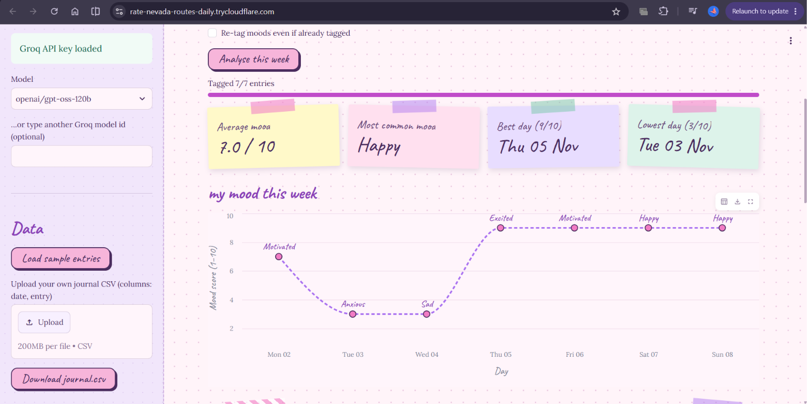
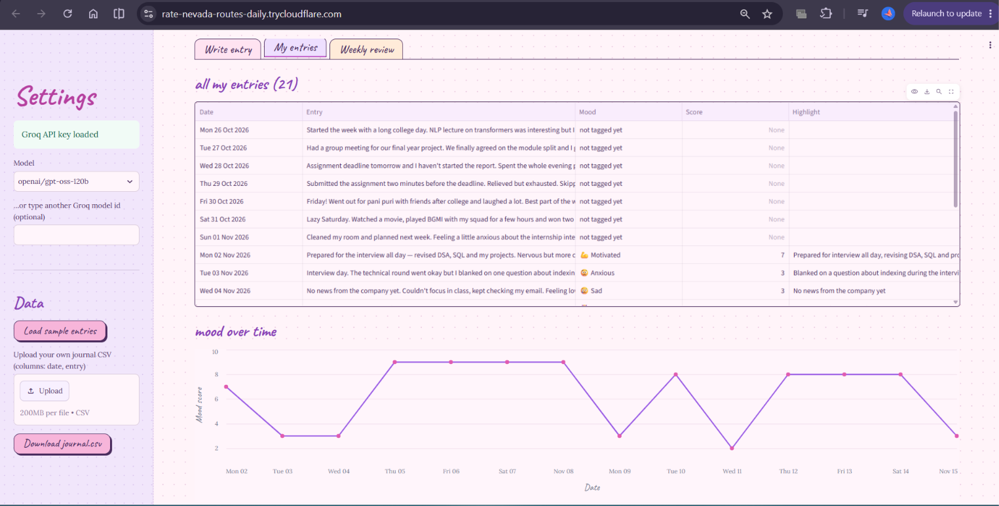

# 📔 Daily Journal Summarizer — LLM Mini Project (PS 47)

**Raginee Chunkhare** · Roll No 47 · LY-AIA-7 · MIT School of Computing, MIT ADT University, Pune

## Problem statement
Journaling without review has little value. This app stores dated journal entries in a CSV, uses an LLM to tag the
mood of each entry, and then summarises each week into mood trends, highlights, challenges and a suggestion — with a
line chart of mood across the week. It helps students and anyone who journals actually learn from what they write.

## Features
- ✍️ Write a daily entry (saved to `journal.csv` with its date)
- 📂 Load 3 weeks of sample entries, or upload your own CSV (`date, entry`)
- 🏷️ LLM tags each entry: mood (fixed list of 10), mood score 1–10, highlight, reason — as JSON
- 📝 Weekly summary: overall mood, mood trend, 3 highlights, challenges, patterns, suggestion
- 📈 Line chart of mood score per day + metrics (average mood, best / lowest day)
- ⬇️ Download the weekly summary as Markdown

## Tech stack
Python · Streamlit · Groq API (`openai/gpt-oss-120b`, JSON mode) · pandas · Altair

## How it works
```
journal.csv ──► pick a week ──► for each entry: prompt 1 (mood tagger) ──► JSON {mood, score, highlight}
                                          │  saved back to the CSV
                                          ▼
                          prompt 2 (weekly coach) ──► JSON summary ──► Streamlit cards + line chart
```

## How to run (local)
```bash
pip install -r requirements.txt
# put your key in a .env file:  GROQ_API_KEY=gsk_...
streamlit run app.py
```
Then click **Load sample entries** in the sidebar → **Weekly review** tab → **Analyse this week**.

## How to run (Google Colab)
Open `run_in_colab.ipynb` in Colab, add your Groq key under 🔑 Secrets as `GROQ_API_KEY`, and run all cells.
The last cell prints a public link to the app.

## Files
| File | Purpose |
|---|---|
| `app.py` | Streamlit UI, CSV storage, chart |
| `journal_llm.py` | Prompts + Groq calls + JSON validation |
| `sample_journal.csv` | 21 sample entries (3 weeks) |
| `run_in_colab.ipynb` | Run the app from Colab |

## Screenshots
<!-- Upload your screenshots to a screenshots/ folder in the repo and they will show here -->



> ℹ️ AI-generated reflections for self-awareness only — not a mental-health assessment.
